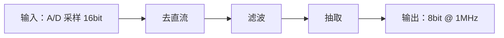

# module-spec:讨论与规格

本环节只确定需求与实现路径,不写 RTL。信息不足就问,用户也无法提供时记录缺口,不得代为假设。
可查资料、读现有工程或写探索原型,但探索结果不是正式证据。

**以下各节是话题,按需取用,不必按序。** 粒度(单模块或整套功能块)、深度(三两句话或多轮讨论)、
取哪几节,均由用户要求决定;单点提问时只谈该项。

## 定方向与器件

**方向**:单个可复用模块,或整机/顶层/板级工程?
工程转 `fpga-project-spec`,定模块清单、连接、器件工程与 IP 策略。

**器件**:目标器件与封装,决定原语、IP、资源估算、约束与 RTL 写法。
模块属于已有工程且工程有 `doc/spec.md` → 以工程 spec 为唯一来源,模块 spec 记"器件见工程 spec";
独立交付模块 → 模块 spec 记型号、系列与封装。
暂未确定可继续讨论,记一笔"器件待定"及其影响,不延后至 RTL 阶段。

**模块根定位**:glob 查找 `**/.fpga-workbench.json`,以其所在目录为模块根;未找到则询问。
锚点含 `kind: module`、`spec: spec/spec.md`;模块根固定含 `spec/`、`rtl/`、`verif/`、`synth/`。
路径记入对话与规格,不作推断。

> **两级目录区分**:模块根规格在 `spec/`,工程根规格在 `doc/`。两处存在
> `spec.md` / `flow.md` / `timing.md` 等同名文件,分属**不同层级**,非同一文件:
>
> | 层级 | 规格 | 框图 | 时序 |
> |---|---|---|---|
> | 模块根(`kind: module`) | `spec/spec.md` | `spec/flow.md` | `synth/timing.md` |
> | 工程根(`kind: project`) | `doc/spec.md` | `doc/flow.md` | `doc/timing.md` |
>
> 引用须带目录前缀。

## 讨论方案(重中之重)

方案决定后续全部工作的意义:方案错误时,RTL 规范性与验证覆盖率都不产生价值。

**要定下来的**:整体数据流(输入、输出)、采用的通用做法或开源实现、不采用其它做法的理由。

### 先定数据流,而非位宽

位宽与协议是数据流的推论,先定数据流。

| 项 | 确定到什么程度 |
|---|---|
| **输入** | 来源(模块/引脚/存储)、格式、有效条件、输入路数 |
| **输出** | 去向、格式、给出条件、下游消费方式 |
| **变换** | 输入到输出的处理级次,近似即可 |

**数据流图(草图)**:对话中的 Mermaid 或文字即可,只求说清输入→变换→输出。



**随后确定**:数据量、速率、流水可行性、缓存需求、反馈回路、控制/数据通路划分。

草案经用户认可后,**定稿图另落 `spec/flow.md`**(见"画实现思路流程图")。

### 搜通用做法与开源实现

定具体实现前先检索现有做法。同一功能通常有成熟解法,自研易遗漏边界条件。
简单逻辑(如加法器、移位)不必检索。

**值得先查的三类**:

| 检索对象 | 依据 | 示例 |
|---|---|---|
| **通用算法 / 经典结构** | 教科书与论文已有最优解 | CORDIC、流水线 FFT、Booth 乘法器、格雷码 FIFO |
| **开源实现** | 反映真实工程取舍(接口与边界处理) | OpenCores、GitHub 上的 Verilog/SystemVerilog 项目、厂商 reference design |
| **厂商 IP / 原语** | 现成实现优于自研 | XPM 宏(CDC/FIFO)、Floating-Point IP、DSP48、Block Memory Generator |

**选定前与用户确认采用哪种**:

- 是否有业界通用做法?采用或不采用的理由
- 开源实现能否参考/移植?许可证是否满足(商用需确认)
- 是否有厂商 IP 可用?与自研的代价对比
- 多种做法代价差异明显时,**由用户选定**(见"什么时候该停下来问")

**不直接复制开源代码**:须能说明其假设与边界。无法理解其实现的代码引入后,
故障排查成本高于自研。

### 把方案讨论透

逐项确定:

- **I/O 精确约定**:位宽、符号、字节序、valid/ready 握手、首尾边界、非法输入处理
- **时序预期**:吞吐率、延迟(拍数)、流水可行性、反压行为
- **资源预期**:LUT/BRAM/DSP 用量级、目标频率
- **异常与边界**:上溢/下溢、超时、复位期间输入、持续背压、满速长时运行
- **上下游接口**:上游数据给出时机、下游接收能力、时钟关系

**用户提出不同做法时先了解其依据**:用户可能掌握本模块之外的约束
(整机时序、既有接口、量产经验)。

### 需要外部资料或原型时

- 有资料 → 读取规格书、厂商文档、论文或既有实现,只提取本模块所需的数字与约束
- 无资料或算法不确定 → 询问是否用 Python 原型验证算法、参数、定点位宽与边界;
  用户不需要时在 spec 记录"无参考"

资料路径、对照数据、参数与取值依据记入 spec 的"参考资料"。探索脚本放**工程外**
(临时目录或用户草稿区)。原型供 **RTL** 取算法与参数、供**验证**生成独立参考模型或 golden;
参考模型不得依据 RTL 编写。

**注意**:探索运行本身不作为证据。正式结论须在对应环节重新运行并保存输出。

## 画实现思路流程图

**要定下来的**:经用户确认的数据通路、状态机、握手与反压、跨时钟位置、流水拍数、存储结构。

定稿图用 Mermaid 写入 `<模块根>/spec/flow.md` 并在对话贴出。5~15 节点,节点写中文与信号名,
关键边标位宽、拍数、时钟。复杂设计拆主流程与子流程。


图与实现或讨论结论不符时更新图。

**注意**:局部 bug 与参数调整无需补图;数据结构、算法路径、状态机或握手时序变化时更新。

## 定验收判据(AC)

**本环节只定"什么算通过",不定"怎么测"。** 测试平台结构与比对格式属验证环节
(见 `fpga-module-verif`)。

**要定下来的**:逐条可检查的 AC,及其期望值来源。

- **AC 写法**:`AC-001`… 逐条可自动检查。**拍数/延迟类判据写成拍数**,
  如"接收后第 N 拍";仅比对数值、不比对时机的判据无法检出时序错位
- **期望值来源**:用户 golden、既有实现输出、或独立 Python 原型
- **输入来源**:实测采集、算法生成、厂商样例或定向边界数据

用户已有数据则请其提供路径与格式;无则由本环节确定判据并记明理由。
纯直通等确无可比行为记 `NOT_APPLICABLE`;判据不可得记 `UNVERIFIED`。

**注意**:输入来源与期望值来源均须写明,不得以输入充当期望。有效样本为 0 不判 `PASS`;
格式、字节序、位宽或文件头不明时先询问。

## 产物与收尾

1. 建骨架,先 `--dry-run`:

   ```
   node "<自带命令目录>\setup-scaffold.mjs" <模块根> --kind module
   ```

   脚本幂等;已有锚点不覆盖(`--force` 才重建),不生成空报告。
2. 写 `<模块根>/spec/spec.md`。`spec_state` 记 `draft`(讨论中)或 `confirmed`(用户确认)。
3. Mermaid 本体单独写入 `spec/flow.md`,spec 仅引用,不存两份。

局部 bug、语法或单条告警不重走规格流程:按 `fpga-module-rtl` 路径 B 处理;缺少
`spec.md` 或 `flow.md` 本身不阻塞。

**用户可能在意的事**:重大架构、公共接口、跨时钟方案、关键数据通路、用户可见的算法决策。
这类改动先与用户对齐;已有批准方案内的普通实现与局部修复直接执行。判据见
`presets/fpga-workbench/workspace/AGENTS.fpga.md` 第 2 条(骨架复制为 `AGENTS.fpga.md`)。

## SPEC 是参考,不是准则

SPEC 记录当前理解,非合同。后续开发随时可调,以用户最新要求为准,不需回本环节确认。

| 情形 | 处理 |
|---|---|
| 开发中接口需增删信号 | 直接改,同步 spec |
| AC 实现时发现不合理 | 按新理解实现,spec 事后对齐 |
| 用户变更算法或器件 | 按用户要求执行,更新 spec |
| 流程图与实现不一致 | 改实现或改图,不需事先请示 |
| spec 数值与实测不符 | 以实测为准,更新 spec |

**唯一硬规则:改完让 spec 反映现状。** 否则接手者依 spec 得到错误信息,危害大于无 spec。

## 什么时候该停下来问

只在这三种情况:

- 需求有两种合理解释,或两条实现路径代价明显不同,且用户未表态
- 需要用户提供的资料(文档、输入、golden、器件型号)或决定(是否上板、目标频率、验收标准)
- 用户提出的做法与现有方案冲突,且不明确其依据

其余一律边做边定。接口增删信号、AC 措辞调整、图与实现对不上,都不必回本环节。

真正缺输入时记 `BLOCKED` 并列出缺项;但它只影响依赖该输入的那部分工作,不是整个环节停摆。
