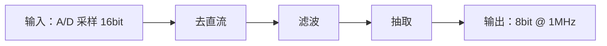

# module-spec:讨论与规格

本环节只确定需求与实现路径,不写 RTL。信息不足就问,用户也无法提供时记录缺口,不得代为假设。
可查资料、读现有工程或写探索原型,但探索结果不是正式证据。

## 本环节最灵活,不要死套(2026-10-29 用户定案)

**规格环节是整个流程里最需要灵活处理的一步。** 下面那些「第一步…第五步」是**参考清单**,
不是必须按序走完的流程:

- **粒度在变**:有时是一个小模块(一个 FIFO),有时是一整个大的功能块(一整套以太网 MAC)
- **深度在变**:小模块可能三句话就够,大功能块要来回讨论很多轮
- **顺序在变**:正写着规格,用户改了需求、或者先看的资料推翻了原方向 —— 直接掉头,
  不用把当前这步"走完"
- **哪步可以跳过**:用户已经把接口和判据都说清楚了,就不用再逐项问一遍

**以用户当下的要求为准。** 用户说"先写个大概",那就写大概;用户说"这里要写死",那就写死。
本技能的作用是**提示该考虑哪些方面**,不是把讨论固定成流程。

## 沟通方式

- 每次围绕一项结论问一到两个问题,依据回答继续;不要一次抛出整张清单
- 已有约定或工程事实直接采用;不确定时先复述理解请用户纠正
- 用 FPGA 术语和短句,不造选项、不让用户填表

## 第一步:确定开发方向(模块 / 工程)

**要定下来的**:本次是单个可复用模块,还是整机、顶层或板级工程。

- 模块 → 继续本技能
- 工程 → 转 `fpga-project-spec`,在那里确定模块清单、连接、器件工程与 IP 策略

未说明就问。再用 glob 查找 `**/.fpga-workbench.json`:找到就读并以其目录为模块根;找不到就询问
模块根,收尾时用脚本建骨架。锚点内容为 `kind: module`、`spec: spec/spec.md`;模块根固定含
`spec/`、`rtl/`、`verif/`、`synth/`。

> **两层目录别搞混**（2026-10-29 补）:模块根的规格在 **`spec/`**,工程根的规格在 **`doc/`**。
> 两处都有 `spec.md` / `flow.md` / `timing.md` 这类同名文件 —— 它们分属**不同层级**,不是同一个文件:
>
> | 层级 | 规格 | 框图 | 时序 |
> |---|---|---|---|
> | 模块根(`kind: module`) | `spec/spec.md` | `spec/flow.md` | `synth/timing.md` |
> | 工程根(`kind: project`) | `doc/spec.md` | `doc/flow.md` | `doc/timing.md` |
>
> 引用时**always 带目录前缀**,别只写 `spec.md`。

**注意**:路径必须在对话与规格中记录,不要靠推断。

## 第二步:确定器件

**要定下来的**:目标器件与封装;器件决定原语、IP、资源估算、约束和 RTL 写法。

- 模块属于已有工程且工程有 `doc/spec.md` → 以工程 spec 为唯一来源,模块 spec 只写“器件见工程 spec”
- 独立交付模块 → 在模块 spec 写型号、系列与封装

**注意**:已有事实直接采用;暂时未定可继续讨论,但须记录“器件待定”及影响,不要拖到写 RTL 时再定。

## 第三步:讨论方案(本环节的重中之重)

**这一节是整份规格里最该花时间的地方。** 前两步是确定方向与器件,第五步是定判据 ——
而**方案对不对,决定后面所有工作有没有意义**。方案错了,RTL 写得再规范、验证覆盖再高,
做出来的东西也不是要的。

**要定下来的**:整个方案的大致数据流(输入什么、输出什么)、采用哪种通用做法或开源实现、
以及为什么不用别的做法。下面 3.1–3.4 是把这个结论谈透的顺序。

### 3.1 先把数据流讲清楚(不是先谈接口位宽)

**开口就问位宽、问协议,是把最该想的事跳过去了。** 先回答这三个问题:

| 问题 | 要具体到什么程度 |
|---|---|
| **输入是什么** | 从哪来(哪个模块/哪个引脚/哪个存储)、什么格式、什么时候有效、有几种输入 |
| **输出是什么** | 到哪去、什么格式、什么条件下给出、下游怎么消费 |
| **中间怎么变** | 从输入到输出经过哪些步骤 —— **大致**即可,不必精确到每拍 |

**画一张粗数据流图**（可以是对话里的 Mermaid，也可以先文字）:



**再问关键的**:数据量多少、速率多少、能不能流水、要不要缓存、有没有反馈回路、
哪些是控制通路哪些是数据通路。

### 3.2 搜通用做法与开源实现(不要从零发明)

数据流讲清楚之后、定具体实现之前,**先查别人怎么做的**。同一个功能几乎总有成熟做法,
从零想容易漏掉边界情况,也容易做出别人踩过坑的结构。

**必须搜的三类**:

| 搜什么 | 为什么 | 例子 |
|---|---|---|
| **通用算法 / 经典结构** | 教科书与论文里已有最优解 | CORDIC、坐标旋转、流水线 FFT、Booth 乘法器、格雷码 FIFO |
| **开源实现** | 能看出真实工程的取舍(不只算法,还有接口与边界处理) | OpenCores、GitHub 上的 Verilog/SystemVerilog 项目、厂商 Xilinx/Intel 的 reference design |
| **厂商 IP / 原语** | 很多功能不用自己写,直接用现成的更快更稳 | XPM 宏(CDC/FIFO)、Floating-Point IP、DSP48 模板、Block Memory Generator |

**搜完要跟用户讨论"用哪种"**,不是自己定了就往下走:

- 这个功能有没有业界通用做法?我们采用还是不用,为什么
- 开源实现能不能参考/移植?它的许可证能不能用(商用要看清)
- 有没有厂商 IP 直接可用?用 IP 与自己写的代价差别多大
- 如果几种做法代价明显不同,**必须让用户选**(这是 skill 里列明的"必须问"情形)

**不要搜完就抄。** 开源实现的质量参差,直接抄进来的代码要能说清它的假设与边界;
抄一个看不懂的实现,出问题时比不抄更糟。

### 3.3 把方案讨论透

**这一步值得多花时间,不要急着往下走。** 具体要逐个谈清:

- **输入输出的精确约定**:位宽、符号、字节序、有效/就绪握手、首尾边界、非法输入怎么处理
- **时序预期**:吞吐率、延迟(多少拍)、能不能流水、反压时怎么表现
- **资源预期**:大概要多少 LUT/BRAM/DSP、目标频率多高
- **异常与边界**:上溢/下溢、超时、复位中途来数据、连续背压、满速长时间跑
- **与上下游的接口**:上游什么时候给数据、下游什么时候能接、双方时钟关系

**用户提出不同做法时,先弄清他的理由再判断** —— 他可能知道本模块之外的约束
(整机时序、既有接口、量产经验),而你看不到。

### 3.4 需要外部资料或原型时

- 有资料 → 读取规格书、厂商文档、论文或既有实现,只提取本模块所需的数字与约束
- 无资料或算法不确定 → 询问是否用 Python 原型验证算法、参数、定点位宽与边界;用户不需要时在
  spec 记录"无参考"

把资料路径、对照数据、参数和取值依据写进 spec 的"参考资料"。探索脚本放**工程外**
(临时目录或用户草稿区即可,不必进模块根)。原型同时供 **RTL** 取算法与参数、供**验证**生成独立参考模型
或 golden;参考模型不得照抄 RTL。

**注意**:探索运行本身不作为证据。正式结论须在对应环节重新运行并保存输出。

## 第四步:画实现思路流程图

**要定下来的**:经用户确认的数据通路、状态机、握手与反压、跨时钟位置、流水拍数及存储结构。

用 Mermaid 写入 `<模块根>/spec/flow.md`,并在对话中贴出。单图 5~15 个节点;节点写中文与信号名,
关键边标位宽、拍数和时钟。复杂设计拆主流程与关键子流程。


将图交用户确认。图未确认即方案未确认;用户要求修改或实现中发现不可行时,先更新图再继续。

**注意**:局部 bug 与参数调整无需补图;数据结构、算法路径、状态机或握手时序变化须同步更新。

## 第五步:定验收判据(AC)

**本环节只定「什么算通过」,不定「怎么测」。** 测试平台怎么搭、用哪种比对格式,
是验证环节的事(见 `fpga-module-verif`)—— 那个阶段才知道 TB 的实际情况。

**要定下来的**:一条条可检查的 AC,以及它们的期望值从哪来。

- **AC 怎么写**:`AC-001`…逐条可自动检查。**拍数/延迟类判据要写成拍数**,
  如「接收后第 N 拍」;只比对数值、不比对时机的判据挡不住时序错位
- **期望值从哪来**:用户 golden、既有实现输出、或第三步的独立 Python 原型
- **输入从哪来**:实测采集、算法生成、厂商样例或定向边界数据

用户已有数据就**请用户提供**路径与格式;没有则**本环节确定**判据并写明理由。
纯直通等确实无可比行为才记 `NOT_APPLICABLE`;拿不到判据记 `UNVERIFIED`。

**注意**:输入来源与期望值来源都要写明,不得用输入冒充期望。有效样本为 0 不得判 `PASS`;
格式、字节序、位宽或文件头不清时先问。

## 产物与收尾

1. 用脚本一次建骨架,先 `--dry-run`:

   ```
   node "<自带命令目录>\setup-scaffold.mjs" <模块根> --kind module
   ```

   脚本幂等;已有锚点不覆盖(`--force` 才重建),也不生成空报告。
2. 写 `<模块根>/spec/spec.md`。`spec_state` 是**进度标记,不是门禁**:
   `draft` = 还在讨论,`confirmed` = 用户确认过 —— **两种状态都能继续往下做**。
3. 将 Mermaid 本体单独写入 `spec/flow.md`,spec 只引用它,不要存两份。

局部 bug、语法或单条告警不重走规格流程:读取已有资料后按 `fpga-module-rtl` 路径 B 处理;缺少
`spec.md` 或 `flow.md` 本身不阻塞,只有关键决策确实不明时才回来讨论。

**什么时候必须先确认图**(不是每次都要):按任务风险判 —— 重大架构、公共接口、跨时钟方案、
关键数据通路、用户可见的算法决策,这些还没定时要先确认;已有批准方案里的普通实现与局部修复
**直接动手**。唯一判据见 `presets/fpga-workbench/workspace/AGENTS.fpga.md` 第 2 条,
骨架会原样复制为 `AGENTS.fpga.md`。

## 本环节的定位:参考,不是准则(2026-10-29 用户定案)

**SPEC 是当前理解的记录,不是必须遵守的合同。** 后续开发中可以随时调整,
**以用户最新要求为准** —— 不需要回到本环节走一遍确认。

具体说:

| 情形 | 怎么做 |
|---|---|
| 开发中发现接口要加一个信号 | **直接改**,顺手把 spec 同步掉 |
| AC 写得不合理(做的时候才看出来) | 按新理解做,spec 事后对齐 |
| 用户临时要求换算法 / 换器件 | **本来就要听用户的**,照做并更新 spec |
| 写到一半发现流程图形与实现不一致 | 改实现或改图,**不用先请示** |
| 规格里的数字和实测对不上 | 以实测为准,把 spec 改成实测值 |

**唯一的硬规则:改完要让 spec 反映现状。**

不是"随便改、文档不管" —— 而是"实现可以自由演进,但 spec 必须跟上"。
否则下一个人(或下一轮对话)读 spec 会拿到错误信息,那它就不只是没用,而是有害。

**什么时候才真的该停下来问**:

- 需要用户提供的资料(文档、golden 数据、器件型号)
- 只有用户能决定的事(要不要上板、目标频率定多少、验收标准放宽与否)
- 两种做法代价明显不同、且用户没表态过

除这三类,其余都可以边做边定,不必回本环节。

## 必须询问用户的情形

- 需求有两种合理解释,或两条实现路径代价不同、且用户没表态过
- 只有用户能提供文档、输入、golden,或决定是否综合/上板、目标频率、验收标准

**注意:上面三类之外的改动不用问。** 接口加个信号、AC 措辞调整、流程图与实现对不上 ——
这些边做边定即可(见上一节)。

## 出口

**没有硬性出口**。规格写到能指导下一步就够了 ——
`spec_state` 是 `draft` 也可以进实现或其它按需环节(定位见上一节)。

真正缺输入时记 `BLOCKED`,在 spec 列出缺项与所需输入;但那也只影响依赖该输入的那部分工作,
不是整个环节停摆。
