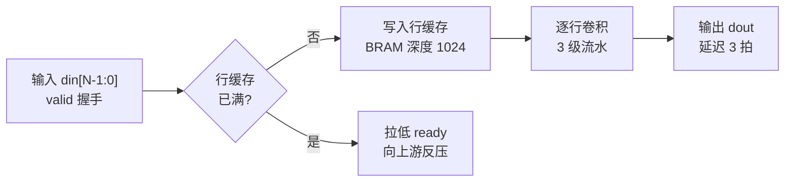

# module-spec:讨论与规格

本环节不写 RTL,只确定"要做什么"并落成规格。下面六步是**讨论的顺序,不是问卷**:每一步以确定一项
结论为目标,信息不足时向用户提问,用户无法提供时如实标注缺口,**不代为假设**。允许查阅文档、阅读
现有工程、写一次性原型验证算法,但探索产物与正式证据须分清。

## 沟通方式

- 直接提问并讨论;不做选项菜单,不把清单当表单让用户逐条填写
- 每次问一到两个问题,依据回答逐步推进;不要一次抛出全部问题
- 用户尚未说明的部分继续询问,**不代为假设,不代为造选项**
- 不确定时先陈述自己的理解请用户纠正,优于让用户自行组织答案
- 用短句;不堆砌小标题与表格
- 用户是 FPGA 工程师,术语直接使用,不作解释

## 第一步:确定开发方向(模块 / 工程)

**要定下来的**:本次是模块级还是工程级开发。

- **模块**(单个 RTL 模块):使用本技能,按下文执行
- **工程**(整机 / 顶层 / 板级):使用 `fpga-project-spec` —— 模块清单、连接关系、器件工程与
  IP 策略均在该处;本技能只覆盖模块级

用户未说明则询问,不要推测:两者的产出、目录结构与讨论内容都不同,方向错了需全部重做。

确定后立即落盘,不要只留在对话里。用 glob 查找 `**/.fpga-workbench.json`:

- **存在** → 读取并遵循,不再询问路径
- **不存在** → 询问阶段文件夹位置(建议模块根),直接建立并告知用户位置

```json
{
  "kind": "module",
  "spec": "spec/spec.md"
}
```

该文件是整套流程的锚点:**其所在目录即阶段文件夹所在目录**。阶段文件夹固定为:

```
spec/  lint/  sim/  comp/  synth/  timing/  review/
```

其中 `spec/` 属于本环节:`spec.md` 放规格,`explore/` 放探索产物。

**注意**:路径推断是整套流程中最易出错、又最难发现的一环,必须询问并记录。

## 第二步:确定器件

**要定下来的**:目标器件与封装。

**讨论内容**:型号 / 系列 / 封装(FPGA 或 CPLD、7 系列或 UltraScale、Xilinx 或 Altera 等)。
**器件决定 RTL 的写法** —— 可用原语与 IP、资源估算、时序约束方式、厂商属性与代码风格都随之变化。

**注意**:

- 用户已说明,或约定文件 / 现有工程中已有 → 直接采用,不重复询问
- 暂时无法确定 → 可继续后面的讨论,但结论中标注**器件待定**及其影响(原语与资源的选择)
- 不要拖到写 RTL 时再定:那时的改动会波及已完成的代码与约束

## 第三步:讨论方案

**要定下来的**:模块的功能、接口、指标,以及实现所依据的参考。

开场讨论三件事:

1. 本模块的功能(一句话)
2. 输入数据、输出数据,以及判定正确的标准
3. 使用位置:上下游模块、时钟与复位来源

接口与指标(吞吐、延迟、反压、资源预期)在三项说明之后再讨论;AC 编号等流程字段最后处理。

### 先建立参考,再确定方案

方案讨论完成后不要直接写 RTL:有参考的模块,后续 RTL 与测试平台均有对照;无参考强行实现,中途
发现理解偏差将导致整块逻辑返工。依据用户手上的材料择一执行:

- **有资料** → 查阅规格书、厂商文档、论文或同类实现;只提取与本模块相关的数字与约束,
  不做整篇摘录
- **无资料或算法不确定** → 询问用户是否先用 Python 建立原型:验证算法、参数取值、定点位宽与
  边界溢出。用户不需要时,须在 spec 中记录"本模块无参考",后续比对环节将缺少 golden

产出为**参考与结论**:对照数据、参数取值、期望输出,以及各项的取值依据。

**原型是后续三个环节共用的参考:**

- **RTL**:算法流程、参数取值、定点位宽以原型为准,不以推测为准
- **测试平台**:原型的输入可作激励,其输出可作期望值,比人工填写期望值可靠
- **比对**:原型是参考模型 / golden 的来源(参考模型须独立于 DUT:依据算法编写,
  不得照抄 RTL 逻辑)

三种用法连同脚本路径一并写入 spec 的「参考资料」一节,供后续环节读取;脚本与中间数据放
`<阶段根>/spec/explore/`,文件名前缀 `explore_`。

**注意**:

- **探索产物不作为证据**:后续环节声明"已验证"时不得只引用 `explore/` 中的内容;可依据原型作为
  参考,但原型那一次运行的输出不能作为本轮结论,须重新运行并将输出写入该环节自己的目录
- 讨论中出现接口或判据层面的变更 → 见文末"必须询问用户的情形"

## 第四步:画实现思路流程图

**要定下来的**:经用户确认的实现路径。

**方案确定后、写 RTL 之前**画出实现思路流程图。用文字描述"要做什么"时最易出错的是**怎么做**:
数据流向、状态跳转、延迟拍数、握手顺序、跨时钟处理。这些用一张图可直接判别对错;写成文字则由
用户自行拼接,错误难以察觉。

图的内容是实现路径,而非重列验收判据:

- **数据通路**:输入 → 各级处理 → 输出;各级规模、流水级数、并行度
- **状态机**:状态集合、跳转条件、异常与超时处理
- **握手与反压**:`valid` / `ready` 的先后关系,反压传播方向与时机
- **时钟域**:异步段划分、跨域位置与同步方式
- **控制与存储**:计数器 / FIFO / BRAM 的作用与深度确定

绘制要求:

- 用 **Mermaid**(` ```mermaid ` 围栏)写入 spec 的「实现思路」一节,并在对话中一并贴出
- 单图 **5~15 个节点**;超出时拆分:主流程一张,关键子流程一张
- 节点标注**中文与信号名**,不使用 A / B / 步骤1 等占位词
- 关键路径标注**位宽、拍数、时钟**



**确认**:将图交用户确认(这条数据路径是否符合预期)。**图未经用户确认即方案未确认**,与 spec
本身同样需要确认。

**注意**:

- 用户要求修改 → 改图后重新确认
- 实现中发现图不可行 → 先说明何处不可行与拟改方案,改图后再继续;不得擅自改换路径
- 局部 bug 修复与参数调整无需补图;涉及数据结构、算法路径、状态机或握手时序的改动,须同步更新图,
  使之与代码一致

## 第五步:明确测试平台与数据要求

**要定下来的**:测试平台的实现要求,以及输入数据与输出数据的来源。**这三项没定,后面的仿真与
比对就没有依据。** 用户有要求则按用户的,没有则由本环节确定并写入 spec。

**讨论内容**:

- **测试平台**:TB 的结构、激励方式、检查点、结果形式(日志 / 波形 / 数据文件)是否已有指定
- **输入数据**:是否已有确定的输入数据(实测采集、算法生成、厂商样例等)
- **输出数据**:是否已有判定基准(用户手上的对照结果、golden 文件、既有实现输出)

**注意**:

- 用户已有数据 → 请其提供路径与格式,并记录格式与规模;没有 → 由本环节决定激励方式(随机、边界、
  定向构造)或依据参考确定期望值,并写明理由
- 数据来源必须写明:输入数据从哪来、期望输出怎么得到 —— 仿真与比对环节直接依赖这两项
- 用户要求的输入数据无法提供、或找不到既有基准时,如实记入 spec 并标注缺口,**不得自行编造数据
  或降低判据**

## 第六步:明确比对要求与对照数据

**要定下来的**:比对的方式与对照数据的来源。适用于需要与参考模型 / golden 对照的模块;纯直通、
纯接口转换这类无需比对的模块记 `NOT_APPLICABLE`,并说明理由。

**讨论内容**:

- **比对要求**:格式(`hex_words` / `text_exact` / `binary_exact` / `custom`)、粒度(逐拍 / 逐字 /
  逐字节 / 逐像素)、容差(是否允许误差、允许多少)、是否要求零差异。用户已指定则按指定,
  没有则由本环节确定并写入验证方案
- **对照数据**:用户手上的 golden 文件、既有实现的输出、或第三步建立的 Python 原型生成。用户已有
  数据则请其提供(路径与格式);没有则由本环节依据原型或资料生成,并写明生成方法与样本规模

**注意**:

- 比对须基于真实 DUT 输出与独立得到的期望值;**有效样本为 0 时不得判 PASS**,应记 `BLOCKED`
  或 `UNVERIFIED`
- 拿不到对照数据时如实标注缺口,**不得用输入数据充当期望值**
- 用户提供的数据若格式不清(字节序、位宽、文件头)→ 先问清再写入 spec,不要留到比对环节才发现

## 清单(自查用,不作为表单提交)

讨论过程中逐项对账,结束时须全部完成。不要一次性列出让用户逐条回答。

- **功能与边界**:做什么、不做什么
- **实现思路**:数据通路、状态机、握手与反压、时钟域 —— 须落成流程图(见第四步)
- **接口**:端口、协议、位宽、时钟、复位、异常行为
- **指标**:吞吐、延迟、反压、资源预期
- **目标器件**与封装
- **验收判据** `AC-001` …:每条须可**自动检查** —— 测试平台、比对或断言之一;无法检查的判据
  须改写为可检查的形式
- **验证方案**:测试平台结构、激励来源、参考模型或 golden 来源、比对格式
  (`hex_words` / `text_exact` / `binary_exact` / `custom`)、通过标准
- **综合与时序策略**:是否综合、目标频率、是否上板
- **参考资料与结论**:文档路径、规格书、现有实现,以及原型(若已建立)的结论 —— 后续环节均需使用

## 产物

写入 `<阶段根>/spec/spec.md`,头部标 `spec_state: draft`,用户确认后改为 `confirmed`。
其中须含**「实现思路」一节**:Mermaid 流程图与关键路径的位宽 / 拍数 / 时钟说明。

**必须先行确认的情形**(流程图与 spec 均须用户确认):新增需求、接口或验收标准变更、正式规格冻结。
上述情形确认前不得继续。

**现有工程的局部 bug 修复无需从头重谈**:读取现有 `spec/spec.md` 与流程图后直接改代码;仅当规格
本身有误或未覆盖时,才与用户讨论并补充。

后续环节只读本规格,不改动;需要变更即回到本环节重新讨论与确认。

确认在对话中完成:先贴流程图请用户确认路径,再说明"已写入 spec.md,请核对理解是否有偏差"。
不要发放逐条打勾的表单。

## 必须询问用户的情形

- 需求存在两种合理解释
- 两条实现路径均可行但代价不同
- 需要变更接口 / 判据 / 器件
- 缺少文档、数据或 golden,只有用户能提供
- 需要决定"是否综合""是否上板"等耗时步骤

## 出口

`spec_state: confirmed` 且清单对账完毕 → 可进入实现与 lint。

存在缺口 → 本环节结论为 **BLOCKED**(不是 PASS),并在 spec 中列出缺项与所需输入。
