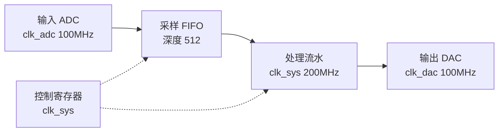

# project-spec:工程规格

**工程级和模块级是两个层级。** 这一阶段定的是整个工程:有哪些模块、怎么连、装在哪个器件上。
单个模块内部的规格由 `fpga-module-spec` 管。

**已有工程也能局部讨论架构**:用户问"这个模块该放哪 / 这两块怎么连 / 要不要加一级 FIFO"时,
直接对着现有 `project/spec/spec.md` 与代码讨论就行,不必先补一份完整的新规格。
**重大选择**(换器件、改模块划分、改对外接口)仍然要用户确认。

## 先立规矩

找约定文件:用 glob 找 `**/.fpga-workbench.json`,里面 `kind` 应该是 `project`。

工程级的阶段文件夹统一放在 **`project/`** 下面,不要跟模块级平铺混在一起 ——
两边都有 `spec` 和 `timing`,同层会撞名:

```
<工作区根>/
├── .fpga-workbench.json        kind: project
├── project/                    ← 工程级阶段文件夹(本阶段:project/spec/)
├── Prj_File/<器件工程>/         ← Vivado 工程,是工具的地盘,不往里写
└── <模块们>/                    ← 每个模块自己一套 spec/ lint/ sim/ …
```

找不到约定文件就问用户:这次是**工程**还是**模块**、工程级文件夹放哪(建议 `project/`)。

## 谈什么

先谈工程要做什么、给谁用、跑在什么条件下,再谈下面这些:

- **需求与架构**:整机做什么、数据从哪进从哪出、各模块怎么分工
- **模块清单表**(这一阶段的产出核心):

  | 模块 | 职责 | 接口 | 依赖 | 做到哪一步 |
  |---|---|---|---|---|
  | … | 一句话 | 时钟/复位/数据 | 依赖谁 | 模块级各阶段的结论 + 审查结论 |

  "做到哪一步"必须是**事实**:指到那个模块的阶段文件夹(`lint/` `sim/` …)里的结论,
  不能写"应该做完了"

  **表里只列这个工程用得到的模块。** 不是每个模块都会走到工程级 —— 有的模块本身就是交付物
  (给别人用的 IP、库模块),它跑完模块级流程、审查通过就算完成,不需要进任何工程。
  哪些模块进这个表,是这一阶段要跟用户定的事。

- **目标器件与工程**:装在哪个器件上、用哪个 Vivado 工程(一个器件一个工程)
- **IP 策略**:哪些用厂商 IP、哪些自己写、IP 放哪(按器件分目录)
- **上板要验什么**:**工程级一般都要上板**,所以这里要问清的是**拿什么验** ——
  板子型号、外设、回读数据的来源、什么算通过;而不是问"要不要上板"

## 画工程框图 —— 和模块级一样,先画出来给他确认

工程级要画的不是算法细节,而是**整机怎么连**:

- **顶层框图**:每个模块一个方块,标清输入/输出、时钟域、挂在哪个总线上
- **数据流**:数据从哪个入口进来、经过谁、从哪出去;控制流单独标一条(别和数据流混在一张线里)
- **时钟与复位**:有哪几个时钟域、各自从哪来、跨越处怎么处理
- **模块清单表**里每个模块的接口,要能在框图上对得上

用 **Mermaid** 画出独立围栏块,放进 `project/spec/spec.md`,**同时贴在对话里**给他看:



一张图 5~15 个方块(实线画数据流,虚线画控制);模块多了就按子系统分两张。

**确认**:问"连接关系是不是这样?哪个接口对不上?" —— 他点头才算方案定了。
**框图没确认 = 工程方案没确认**;后面集成时发现连不起来,先回来改图再动手。

## 出口

`project/spec/spec.md` 写完(含**框图**与模块清单表)且用户确认,模块清单表里每个模块的
"做到哪一步"都指得回去。有模块还没跑完模块级流程 → 如实写出来,**不要假设它会过**。

## 必须停下来问用户的时候

- 器件选型或工程选择有取舍(资源、成本、已有工程的复用)
- 模块怎么划分有两种合理方案
- 要不要上板、上板拿什么数据验,只有用户能定
- 某个模块的状态说不清 —— 那是要回去补模块级,不是在这里猜
