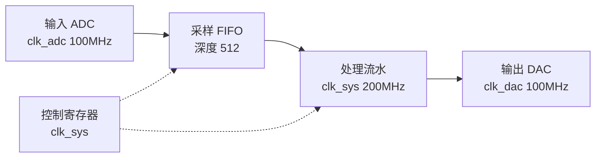

# project-spec:工程规格

**工程级与模块级分属两个层级。** 本环节确定整个工程:有哪些模块、如何连接、装在哪个器件上。
单个模块内部的规格由 `fpga-module-spec` 负责。

**已有工程亦可局部讨论架构**:用户问"这个模块该放哪 / 这两块怎么连 / 要不要加一级 FIFO"时,
直接对着现有 `project/spec/spec.md` 与代码讨论即可,不必先补一份完整的新规格。
**重大选择**(换器件、改模块划分、改对外接口)仍须用户确认。

## 先立规矩

查约定文件:用 glob 查 `**/.fpga-workbench.json`,其中 `kind` 应为 `project`。

工程级的环节文件夹统一放在 **`project/`** 之下,不与模块级平铺混放 ——
两者都有 `spec` 与 `timing`,同层会撞名:

```
<工作区根>/
├── .fpga-workbench.json        kind: project
├── project/                    ← 工程级环节目录(本环节:project/spec/)
├── Prj_File/<器件工程>/         ← Vivado 工程,是工具的地盘,不往里写
└── <模块们>/                    ← 每个模块一套 spec/ rtl/ sim/ comp/ synth/ timing/
```

找不到约定文件即询问用户:本次是**工程**还是**模块**、工作区根目录在哪 —— 骨架由脚本在收尾时
一次性建立(见"出口"),讨论过程中不要手工建目录。

## 谈什么

先谈工程要做什么、给谁用、跑在什么条件下,再谈下列各项:

- **需求与架构**:整机做什么、数据从哪进从哪出、各模块如何分工
- **模块清单表**(本环节的产出核心):

  | 模块 | 职责 | 接口 | 依赖 | 做到哪一步 |
  |---|---|---|---|---|
  | … | 一句话 | 时钟/复位/数据 | 依赖谁 | 模块级各环节的结论 + 审查结论 |

  "做到哪一步"必须是**事实**:指到该模块环节目录(`rtl/` `sim/` …)里的结论,
  不得写"应该做完了"

  **表里只列本工程用得到的模块。** 并非每个模块都会走到工程级 —— 有的模块本身即为交付物
  (供他人使用的 IP、库模块),它跑完模块级流程、审查通过即算完成,不需要进任何工程。
  哪些模块进这张表,是本环节要与用户确定的事。

- **目标器件与工程**:装在哪个器件上、用哪个 Vivado 工程(一个器件一个工程)
- **IP 策略**:哪些用厂商 IP、哪些自己写、IP 放哪(按器件分目录)
- **上板要验什么**:**工程级一般都要上板**,故此处要问清的是**拿什么验** ——
  板子型号、外设、回读数据的来源、什么算通过;并非问"要不要上板"

## 画工程框图 —— 与模块级一致,先画出并请用户确认

工程级框图的内容是**整机怎么连**,不涉及算法细节:

- **顶层框图**:每个模块一个方块,标清输入/输出、时钟域、挂在哪个总线上
- **数据流**:数据从哪个入口进来、经过谁、从哪出去;控制流单独标一条(不与数据流混在同一张线里)
- **时钟与复位**:有哪几个时钟域、各自从哪来、跨越处如何处理
- **模块清单表**里每个模块的接口,要能在框图上对得上

用 **Mermaid** 画出独立围栏块,放进 `project/spec/spec.md`,**同时贴在对话里**供用户查看:



一张图 5~15 个方块(实线画数据流,虚线画控制);模块多了就按子系统分两张。

**确认**:请用户核对连接关系、指出对不上的接口 —— 用户确认后方可视为方案确定。
**框图未确认即工程方案未确认**;后续集成时发现连不起来,先回来改图再动手。

框图同样**单独成文**:写入 `project/spec/flow.md`(Mermaid 本体),spec.md 里指向它,
不在两处各存一份。

## 出口

方案确认后一次建好骨架 —— **不要手工逐个建目录**:

```
node "<自带工具目录>/init-scaffold.mjs" <工作区根> --kind project --modules <模块名,逗号分隔>
```

它写工作区根的 `.fpga-workbench.json`(`kind: project`)、建好 `project/` 下全部工程级环节目录,
并给每个模块各自建一套模块级环节目录(含各自的锚点)。先加 `--dry-run` 看一遍;已有锚点不覆盖
(要重建用 `--force`)。**它只建目录,不生成空的 spec.md / flow.md。**

然后写 `project/spec/spec.md`(含**框图位置**与模块清单表)与 `project/spec/flow.md`,经用户确认,
模块清单表里每个模块的"做到哪一步"都指得回去。有模块尚未跑完模块级流程 → 如实写出来,
**不得假设它会通过**。

## 必须停下来问用户的时候

- 器件选型或工程选择有取舍(资源、成本、已有工程的复用)
- 模块怎么划分有两种合理方案
- 要不要上板、上板拿什么数据验,只有用户能定
- 某个模块的状态说不清 —— 那是要回去补模块级,不得在这里猜
