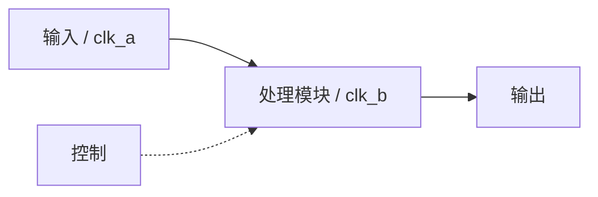

# project-spec:工程规格

本环节确定整机目标、器件、模块划分与连接。可复用模块用 `fpga-module-spec`;工程专用模块只在
`src/rtl/` 实现。已有工程的局部架构问题可直接依据现有 `doc/spec.md` 与代码讨论;换器件、改模块划分
或外部接口仍须用户确认。

## 前置

1. 确认是工程级任务;单个可复用模块转 `fpga-module-spec`
2. 确认用户指定的工程目录,该路径直接作为工程根
3. 读取现有需求、工程、模块库与 `.fpga-workbench.json`,不得凭印象补事实

## 目录树

```text
<用户指定工程目录>/
├── .fpga-workbench.json     kind: project
├── doc/                     spec、flow、files 与工程报告
├── sch/                     原理图、器件和协议资料
├── prj/                     Vivado 工程及工具生成物
├── src/rtl/                 顶层、专用及拷入的可复用 RTL,全部平铺
├── src/sim/                 专用模块简单 tb,不作为正式证据
├── ip/<ip-name>/            一 IP 一目录
├── sim/                     工程级 tb、脚本、日志、波形和比对结果
├── xdc/                     工程约束
└── bit/                     当前实现的 bit/ltx
```

- `doc/` 平铺工程结论;参考资料进 `sch/`;工程 Tcl 留在 `prj/`
- `prj/` 由 Vivado 自己生成内容,并引用 `src/`、`ip/`、`xdc/` 原文件,不得复制第二份
- `src/rtl/` 文件名冲突就停下来问;根 `sim/` 才能产出工程级仿真证据
- `bit/` 可由每次实现覆盖同名 bit/ltx;其它用户文件不得静默覆盖
- 找不到 `kind: project` 锚点就确认工程/模块边界与工程根,再用脚本建树

## 讨论顺序

### 1. 工程目标

确定使用场景、板卡/产品、外设、顶层功能和验收目标,此时不建目录。

### 2. 定器件与工程名,建立骨架

确定完整 part 与工程名;工程名写入 `doc/spec.md`,用户指定目录仍是工程根。两项确定后执行“出口”的
脚本,不要手工建目录。

### 3. 读取参考资料

请用户把原理图、器件手册、管脚表和协议资料放入 `sch/`;先读事实,再划分模块、时钟与复位。

### 4. 形成具体规格

模块清单写进 `doc/spec.md`:

| 模块 | 专用/可复用 | 职责 | 接口(短) | 来源 |
|---|---|---|---|---|
| … | … | … | 时钟/复位/数据 | 库路径 / 本工程写 |

模块来源按以下规则处理:

| 类型 | 处理 |
|---|---|
| 库里已有的可复用模块 | 只拷入,不重写 |
| 库里缺少的可复用模块 | 停止该模块并报告,等模块级流程完成后再拷入 |
| 工程专用模块 | 交 `fpga-project-rtl`;简单 tb 放 `src/sim/`,不另写模块规格 |

从模块库只取以下运行文件,并在 `doc/files.md` 记录工程位置与来源:

| 从库 | 落点 |
|---|---|
| `<模块>/rtl/` 下 RTL | `src/rtl/` |
| `.xci` / `.bd` / `.coe` 与 `timing.json` | `ip/<ip-name>/` |
| `<模块>/verif/tb_*.sv` 或 `tb_*.v` | `src/sim/` |

不拷模块 spec、报告、仿真脚本和 golden。专用模块简单 tb 须跑过一次,只作开发反馈;顶层靠 elaborate、
综合连通性与根 `sim/` 工程仿真。

同时确定:

- 模块接口、时钟树、复位极性与释放顺序
- 按需扫描用户给出的模块库;先报告现成模块再决定取用
- IP 策略:优先厂商原语 / XPM;确需 IP 时按 `fpga-module-rtl` 规则生成并放 `ip/<ip-name>/`
- 上板对象、外设、回读数据和独立通过判据

## 画工程框图

框图表示模块、数据/控制流、时钟复位和跨域位置,不展开算法。一张图 5~15 个节点;用 Mermaid 写入
`doc/flow.md`,同时贴在对话中;`doc/spec.md` 只引用该文件。



清单中每个模块和接口都要能在图上对应。请用户确认连接关系;图未确认即工程方案未确认。

## 文件清单 `doc/files.md`

只记录工程路径与来源(库路径 / 手写 / 工具生成),不锁哈希。文件变化就同步;工程确认时逐项检查路径
存在且来源清楚。未对完账不得写 `PASS`。

## 出口

骨架若尚未创建,先 `--dry-run`,再执行:

```text
node "<自带命令目录>\setup-scaffold.mjs" <用户指定工程目录> --kind project
```

脚本写锚点、固定目录和 `AGENTS.fpga.md`;不生成空报告,已有文件不覆盖(`--force` 才重建)。
旧 `--modules` 已停用;工程 RTL 始终平铺在 `src/rtl/`。

## 后续能力

spec 确认后没有固定流水线:集成、专用 RTL、仿真、lint、综合、约束、实现、时序、上板和发布均按需
选用并可回跳。综合前尽量让 RTL、仿真与约束就绪;上板须有当前 bit、可信约束与时序结论。

## 产物与判据

- 结论(`PASS` / `FAIL` / `BLOCKED` / `UNVERIFIED` / `NOT_APPLICABLE`)
- `doc/spec.md`:状态、part、工程名、顶层、时钟目标、复位、需求、模块清单、IP 与上板目标
- `doc/flow.md`:经确认的 Mermaid 框图
- `doc/files.md`:工程路径与来源

方案、框图和文件清单均确认 → `PASS`;真实不符 → `FAIL`;缺用户资料或可复用模块 → `BLOCKED`;
证据或工作未完成 → `UNVERIFIED`;本次确实无工程级规格工作 → `NOT_APPLICABLE`。
判定词含义见 `fpga-module-verif` 的状态表(唯一权威)。
  · 速记:`PASS`有证据 / `FAIL`真不符 / `BLOCKED`缺条件 / `UNVERIFIED`没验 / `NOT_APPLICABLE`确不适用且不掩盖无法验证

## 必须停下来问用户的时候

- 器件选择、模块划分或专用/可复用边界有合理分支
- 可复用模块库里没有,或原理图/连接资料缺失或看不清
- 只有用户能确定上板输入、回读数据或验收标准
