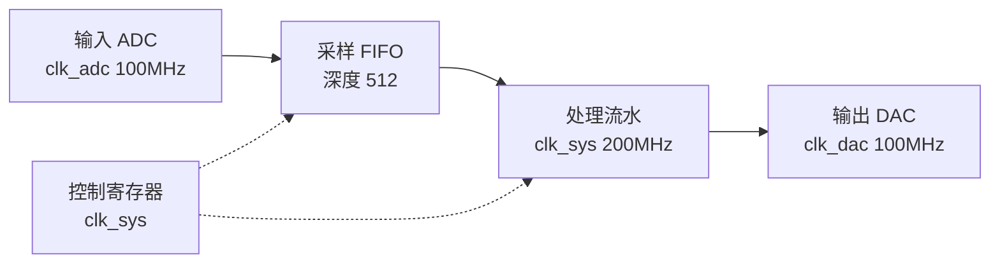

# project-spec:工程规格

**工程级与模块级分属两个层级。** 本环节确定整个工程:有哪些模块、如何连接、装在哪个器件上。
可复用模块的完整规格由 `fpga-module-spec` 负责;工程内的**专用模块**只写 RTL + 简单 sim,不走模块流程。

**已有工程亦可局部讨论架构**:用户问"这块怎么连 / 要不要加一级 FIFO"时,直接对着现有
`doc/spec.md` 与代码讨论即可,不必先补一份完整的新规格。**重大选择**(换器件、改模块划分、
改对外接口)仍须用户确认。

## 前置

1. 确认本次是**工程**(而不是单个可复用模块)—— 没说明就问,见 `fpga-module-spec` 第一步
2. 用户指定的工程目录是哪一个(这个路径本身就是工程根,不再自动套一层“工程文件夹”)
3. 手上有哪些材料:需求、既有工程、模块库位置 —— 已有结论按需读,别凭印象假设

## 目录树(定稿,建树就按这个)

```
<用户指定工程目录>/
├── .fpga-workbench.json     kind: project
├── doc/                     工程级报告 + 文件清单 files.md(扁平固定名)
├── sch/                     原理图、器件手册等参考件
├── prj/                     Vivado 工程(工具地盘:编译/综合/布局布线,不写报告)
├── src/
│   ├── rtl/                 全部工程 RTL 平铺(含顶层、专用模块、拷入的可复用模块)
│   └── sim/                 专用模块的简单 sim；只作开发反馈,不算工程证据
├── ip/                      用到的 IP(.xci 等)
├── sim/                     工程级仿真(tb、脚本、日志、波形与比对结果)
├── xdc/                     用到的 xdc
└── bit/                     实现后的 bit + ltx,拷一份覆盖、不改名
```

约定:

- **`doc/` 是工程级结论区**:所有技能报告、`spec.md`、`flow.md` 与 `files.md` 都平铺在这里。
- 原理图、器件手册、协议资料统一进 `sch/`;IP 初始化文件随对应 IP 放 `ip/`;工程 Tcl 随
  Vivado 工程放 `prj/`,仿真 Tcl/DO 放对应的 `sim/` 或 `src/sim/`。
- **`prj/` 只给空目录**。用 Vivado「Create Project」时把工程位置指到 `prj/`,`.xpr` / `runs/` /
  `.cache` 那套由工具自己长;**不预建**命名子文件夹,不往 `prj/` 里写报告。
  建好的工程必须**引用** `src/` `ip/` `xdc/` 里的文件(external reference),**不得再复制一份**进工程。
- **`src/rtl/` 全部平铺**:顶层、专用模块和拷入的可复用 RTL 都在这里,不按模块或功能再建层级。
  文件名撞了就停下问用户,不得静默改名覆盖。
- **两类仿真严格分开**:`src/sim/` 是专用模块的简单 sim,不算证据；根 `sim/` 是工程级仿真,
  其日志/波形/比对结果才可被工程报告引用。顶层不要求简单自测,靠 elaborate + 工程级仿真。
- **`bit/` 允许覆盖**:每次实现后拷 bit/ltx 覆盖、不改名(唯一允许覆盖的归档点;不是删除)。

找不到 `.fpga-workbench.json`(`kind: project`)即询问用户:本次是**工程**还是**模块**、用户指定
工程目录是哪一个。目录树由脚本一次建好(见「出口」),讨论过程中不要手工建目录。

## 谈什么(顺序)

### 1. 工程目标

先谈工程要做什么、给谁用、跑在什么条件下、板子/产品是什么、顶层要什么功能。**此时不建目录。**

### 2. 定器件与工程名 → 立刻建树

- **目标器件**:装在哪个器件上(决定 Vivado 建工程时的 part)
- **工程名**:只写进 `doc/spec.md`,**不拿来建文件夹**;Vivado 工程名由建工程时定
- 两项定下来就跑脚本建好整棵树(见「出口」),不要拖到收尾

### 3. 要参考资料,放进 `sch/`,读完再谈 spec

向用户要原理图、器件手册、管脚表、协议说明等,**请他放进 `sch/`**(其它项目文档他愿意的话
也放 `sch/`)。放好后**先读**,再进入第 4 步 —— 后面拆模块、定时钟复位都以 `sch/` 里的事实为依据,
不凭空拆。

### 4. 具体 spec

- **模块清单**(本环节的产出核心,清单表进 `doc/spec.md`,文件级清单进 `doc/files.md`):

  | 模块 | 专用/可复用 | 职责 | 接口(短) | 来源 |
  |---|---|---|---|---|
  | … | 专用 | 一句话职责 | 时钟/复位/数据 | 库路径 / 本工程写 |

- **可复用 vs 专用**(先判断,判断结果向用户报告并确认):

  | 判定 | 怎么做 |
  |---|---|
  | 可复用,库里有现成 | 按下面「从库拷什么」拷入;**不重写** |
  | 可复用,库里没有 | **停止该模块的编写并报告用户**;等人工按模块级流程写完,再按同一规则拷入 |
  | 本工程专用 | 用 `fpga-project-rtl` 在 `src/rtl/` 写,简单 sim 放 `src/sim/`;**不走模块流程、不写模块需求**。可先定接口进清单,RTL 在集成后用 `fpga-project-rtl` 补齐 |

- **从库拷什么**(库是**完整模块级树** `rtl/` `verif/` `…`;工程里肯定会改,所以只当参考源):

  | 从库 | 拷什么 | 落到 |
  |---|---|---|
  | `<模块>/rtl/` | RTL 文件(`.sv` / `.v` 等) | `src/rtl/`(平铺) |
  | IP | `.xci` 与对应初始化文件 | `ip/` |
  | `<模块>/verif/` | **仅 `tb_*.sv` / `tb_*.v`** | `src/sim/` |

  **不拷**:`spec/`、各类报告、模块仿真脚本、golden/对照数据 —— 工程级仿真在根 `sim/` 另写。
  每拷一批,在 `doc/files.md` 记「工程里的位置 + 参考来源(库路径)」。

- **专用模块的简单 sim 标准**:在 `src/sim/` 有 `tb_*`、**跑过一次**、确认没啥大问题即可。
  **不算正式证据**,不进验收链;缺工具跑不了就如实说,不要假装跑过。
  **顶层不算专用模块**:顶层不要求简单自测,靠 elaborate / 综合连通性 + 工程级仿真。

- **扫模块库**:讨论过程中**按需**扫,不写死时机。扫之前问用户库在哪(或用他当场给的路径)。
  全量扫描后报告有哪些现成模块,再决定拷哪个。
- **接口与时钟复位**:模块间怎么接、时钟树、复位极性与释放顺序。专用模块不写独立需求文档,
  接口以清单表 + RTL 为准。
- **IP 策略**:哪些自己写、哪些用厂商 IP。**能用厂商原语 / XPM 参数化宏的就不用 IP 向导**,
  不在图形界面上点(判据见 `fpga-module-rtl` 的「需要 IP 核时」);IP 文件进 `ip/`。
- **上板要验什么**:板子型号、外设、回读数据来源、什么算通过(工程级一般都要上板)。

## 画工程框图 —— 先画出并请用户确认

内容是**整机怎么连**,不涉及算法细节:

- **顶层框图**:每个模块一个方块,标清输入/输出、时钟域、挂在哪个总线上
- **数据流**与**控制流**(控制用虚线,不与数据混在同一张线里)
- **时钟与复位**:有哪几个时钟域、各自从哪来、跨越处如何处理
- 清单里每个模块的接口,要能在框图上对得上

用 **Mermaid** 画出独立围栏块,写入 `doc/flow.md`,**同时贴在对话里**供用户查看;
`doc/spec.md` 里指向 `flow.md`,不在两处各存一份:



一张图 5~15 个方块;模块多了就按子系统分两张。

**确认**:请用户核对连接关系、指出对不上的接口。**框图未确认即工程方案未确认**;
后续集成时发现连不起来,先回来改图再动手。

## 文件清单 `doc/files.md`

- **单独一份文件**,不是塞在 spec 里的附录
- **只记两样**:**工程里的位置** + **参考来源**(库路径 / 手写 / 工具生成)。
  工程里几乎一定会改拷进来的文件,所以**不核哈希、不锁版本**
- **随时可改**:加了文件、拷了库、起了 sim,就去记一行
- **工程确认完成后完整对一遍** —— 防止只顾写代码忘了记录;对不上的当场补
- 对账通过的含义:清单上的**路径都在**、**来源写得清**;有缺口就补,补完再算齐

## 出口

方案确认后骨架应已建好(第 2 步就建了)。若还没有,一次建好 —— **不要手工逐个建目录**
(这条命令两级共用,所以在 `tools/` 顶层):

```
node "<自带命令目录>\setup-scaffold.mjs" <用户指定工程目录> --kind project
```

它直接在该路径写 `.fpga-workbench.json`(`kind: project`),并创建 `doc/` `sch/` `prj/`
`src/rtl/` `src/sim/` `ip/` `sim/` `xdc/` `bit/`;不会再套工程名目录，也不会创建模块子目录。
同时落一份本模式的工作区规则 `AGENTS.fpga.md`(已存在就跳过)。先加 `--dry-run` 看一遍;
已有锚点不覆盖(要重建用 `--force`)。**它只建目录,不生成空的 spec.md / flow.md / files.md。**
`--modules` 已停用；工程 RTL 统一平铺在 `src/rtl/`。

## 之后没有固定流程

**本技能是工程级唯一相对有顺序的一步**(目标 → 器件/建树 → 读 `sch/` → 清单与框图)。
**spec 定下之后,其余环节没有固定流程** —— 都是按需取用的能力,不是流水线:

| 能力 | 技能 |
|---|---|
| 接顶层 / 进工程 | `fpga-project-integrate` |
| 写专用 RTL / IP / BD | `fpga-project-rtl` |
| 仿真 | `fpga-project-syssim` |
| lint | `fpga-project-lint` |
| 综合 | `fpga-project-synth` |
| 约束 / 管脚 | `fpga-project-constraints` |
| 布线 / bit | `fpga-project-impl` |
| 时序 | `fpga-project-timing` |
| 上板 | `fpga-project-board` |
| 发布 | `fpga-project-release` |

- **随便挑、随便跳、随便停**;软约束只有两条:综合前尽量 `rtl`/`sim`/`xdc` 完好;
  上板前约束与时序要站得住、`bit/` 对应当前代码
- impl → timing → board → release 有**依赖**(没 bit 不能上板),但**不是**必须走完的流水:
  只做综合、只改 RTL、只写约束,都合法

## 产物

- `doc/spec.md`:结论(`PASS` / `FAIL` / `BLOCKED` / `UNVERIFIED` / `NOT_APPLICABLE`)
  + **固定小节**:器件 part、工程名、**顶层模块名**、时钟目标、复位约定
  + 需求与架构 + **模块清单表**(专用/可复用 / 职责 / 接口 / 来源)+ IP 策略 + 上板要验什么
  + 指向 `doc/flow.md`(判定词的含义见 `fpga-module-verif` 的**状态表**,唯一权威)
- `doc/flow.md`:整机框图(Mermaid 本体)
- `doc/files.md`:文件清单(位置 + 参考来源;随时可改;工程确认后对完账再算齐)

**`doc/files.md` 没对完账 → 不得写 `PASS`**(与 `fpga-project-release` 同一条口径)。

清单里可复用模块若「库里没有」→ 该模块**停止编写**并如实写出缺项,结论按整体进度记
`BLOCKED` 或 `UNVERIFIED`,**不得假设它会通过**。方案与框图确认完毕、文件清单对账完毕 →
`PASS`;这次不涉及工程级改动 → `NOT_APPLICABLE`。

## 必须停下来问用户的时候

- 器件选型有取舍(资源、成本、已有板卡)
- 模块怎么划分有两种合理方案,或某个模块专用/可复用判不准
- 可复用模块库里没有 —— 等人工写,不得自行补写通用模块
- 要上板拿什么数据验,只有用户能定
- 原理图还没放进 `sch/`、或图上看不清某条连接 —— 先问,不得猜管脚与连接
