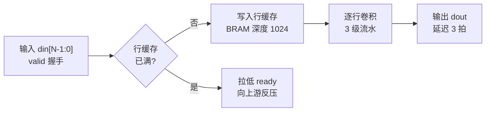

# 阶段 0:讨论与规格

**这个阶段不写 RTL。** 它只干一件事:把"要做什么"谈清楚,落成一份规格。允许做任何探索 —— 读文档、翻现有工程、写一次性原型试算法 —— 但探索和交付要分清。

## 怎么谈

**直接问问题,然后讨论。不要给选项菜单,不要把清单当表单让人挑。**

- 一次问一两个,顺着他的回答往下追;别一口气抛八个问题
- 不要写"你选 A 还是 B 还是 C"。他还没说清的地方就继续聊、继续问 —— **不要替他造选项**
- 拿不准时先说你的理解让他纠正("我理解是……,对吗?"),比他面对一堆问题自己组织答案快
- 中文、口语、短句。这不是写报告,别用小标题和表格铺满屏幕
- 他做 FPGA 的,术语直接用,不用解释什么是 CDC

## 先谈功能,不谈流程字段

开场只问三件事:

1. 这个模块要做什么?(一句话)
2. 输入是什么数据、输出是什么、什么算对?
3. 它嵌在哪:上下游是谁、时钟和复位从哪来?

这三件谈完,再谈接口与指标。**不要一上来就问"器件型号是什么""AC 怎么编号"** —— 用户还没说清功能时,那些字段只会打断他。

## 先立规矩:问一次,记下来

在这个模块里干活之前,先找约定文件:用 glob 找 `**/.fpga-workbench.json`。

- **找到了** → 读它,按它干活,不要再问路径。
- **没找到** → 在讨论里顺带问清楚:这次做的是**模块**还是**工程**、阶段文件夹想放哪(建议就放模块根)。
  问清了直接建出来,建完告诉他一句放哪了 —— 不要为这点事专门开场审问,也不用征求同意才建。

```json
{
  "kind": "module",
  "spec": "spec/spec.md"
}
```

这个文件是整套流程的锚点:**它在哪,阶段文件夹就在哪**。阶段文件夹固定是这几个名字 ——

```
spec/  lint/  sim/  comp/  synth/  timing/  review/
```

`spec/` 是本阶段的:`spec.md` 放规格,`explore/` 放探索产物。

**猜路径是这套流程里最容易出错、又最难发现的地方**,所以这里必须问、必须记。

## 有了功能描述之后:先建参考,再定方案

**功能谈完,不要直接开始写 RTL。** 先给它找参考。这一步是必要的:有参考的模块,后面写 RTL、
写测试平台都有对照,难度低得多;没有参考硬写,做到一半发现理解错了,返工的是整块逻辑。

看手上有什么,走其中一条:

- **有资料** → 找来看:规格书、厂商文档、论文、同类实现。只看与本模块有关的部分,提取数字与
  约束,不要整篇摘抄
- **没资料,或算法没把握** → 用 Python 写个原型跑一遍,验:算法对不对、参数取多少、
  定点化位宽够不够、边界数据会不会溢出

产出是**参考与结论**:对照数据、参数取值、期望输出,连同"为什么这么定"一起写下来。

**原型不是白写的** —— 跑通之后它就是 comp 阶段(算法验证)的参考模型 / golden 来源,直接接着用。

放哪:脚本和中间数据进 `<阶段根>/spec/explore/`,文件名前缀 `explore_`;结论写进 spec 的
「参考资料」一节(来源 + 结论)。

**探索产物不是证据。** 后面任何环节说"已验证",都不许只引用 `explore/` 里的东西 ——
正式证据要由对应阶段自己产出。

## 画实现思路流程图 —— 这一步不能省

**方案谈定之后、动手写 RTL 之前,把实现思路画成流程图给他确认。** 光用文字说"要做什么",
最容易错的是**怎么做**:数据怎么流、状态机怎么跳、几拍出结果、握手谁等谁、跨时钟在哪处理。
这些用一张图摆出来,他一眼就能看出对不对;写成三段文字,他自己在脑子里拼,错了也说不清。

画什么(是**实现路径**,不是把验收判据列一遍):

- **数据通路**:输入 → 各级处理 → 输出;每级的规模、流水级数、并行度
- **状态机**:有哪些状态、跳转条件、异常与超时怎么走
- **握手与反压**:`valid`/`ready` 谁等谁,反压往哪传、什么时候拉低
- **时钟域**:哪几段是异步的、跨域在哪、怎么同步
- **控制与存储**:计数器 / FIFO / BRAM 各自的作用,深度怎么定

怎么画:

- 用 **Mermaid** 画(` ```mermaid ` 围栏),放在 spec 的「实现思路」一节 —— DSH 里能直接渲染,
  同时**在对话里也贴一份**给他看
- 一张图 **5~15 个节点**;超过就拆:"主流程一张 + 关键子流程(比如那个 FIFO 的满/空处理)一张"
- 节点写**中文 + 信号名**,别用 A / B / 步骤1 这种占位词
- 关键路径上标清**位宽、拍数、时钟**



**确认**:把图给他看,直接问"这条路径是不是你想的?哪里不对?" —— 他说没问题了,才算方案确认。
**图没确认 = 方案没确认**,跟他确认过 spec 一样,都要落在对话里。

- 他要改:改图 → 再确认一次(改了图就等于改了方案)
- 后面实现时发现图走不通:先跟他说清"哪里走不通、打算怎么改",改完图再继续 ——
  不要默默换一条路写下去
- 局部 bug 修复、只调参数**不用补图**;但只要动到数据结构、算法路径、状态机或握手时序,
  就得把图更新到与代码一致

## 你自己心里的清单(不是给用户填的表)

讨论到哪儿对到哪儿。**不要把它一次性贴出来让人逐条回答** —— 它是你结束时要对完的账:

- **功能与边界**:做什么、**不做什么**
- **实现思路**:数据通路、状态机、握手与反压、时钟域 —— 这一条要落成**流程图**(见上)
- **接口**:端口、协议、位宽、时钟、复位、异常行为
- **指标**:吞吐、延迟、反压、资源预期
- **目标器件**与封装
- **验收判据** `AC-001` …:每条都要能被**自动检查** —— 测试平台、比对、断言三者之一。检查不了的判据不算判据,要改写成能检查的
- **验证方案**:测试平台怎么搭、激励从哪来、参考模型或 golden 怎么来、比对格式(`hex_words` / `text_exact` / `binary_exact` / `custom`)、**什么算通过**
- **综合与时序策略**:要不要综合、目标频率、要不要上板
- **参考资料与结论**:文档路径、规格书、既有实现,以及原型(如果做了)验出来的结论 —— 这几条后面每个阶段都要用

## 产物

写进 `<阶段根>/spec/spec.md`,头部标 `spec_state: draft`;他确认后改成 `confirmed`。
里面要有**「实现思路」一节**:Mermaid 流程图 + 关键路径的位宽 / 拍数 / 时钟说明。

**什么时候必须先确认**(这两样都要他点头:实现思路的流程图 + spec 本身):新增需求、接口或
验收标准要变、以及正式规格冻结 —— 这几种情况下确认之前不要往下做。
**已有工程的局部 bug 修复不必从头重谈**:先读现有 `spec/spec.md` 与那张流程图,按它改代码就行;
只有发现规格本身写错了(或没覆盖到)才回头找他谈,谈完把那条补进去。

后面的环节只读这份规格、不改它 —— 要改就是回头重谈,谈完重新确认。

确认这件事也在对话里做:先把**流程图**贴出来问"这条路是不是你想的",再把
"谈好的几点写进 spec.md 了,你看一眼有没有理解错的"告诉他 —— 而不是发一张逐条打勾的表让他填。

## 如果这次是工程(kind = project)

只做两件事,**不要自己设计工程级的阶段**:

1. 问用户模块怎么摆(每个模块各自一套阶段文件夹)
2. 在 spec 里写一张**模块清单表**:每个模块一行 —— 名字 / 职责 / 接口 / 依赖 / 做到哪一步

工程级流程(顶层集成、约束与管脚、系统仿真、bitstream、上板)以后再做,现在不碰。

## 必须停下来问用户的时候

- 需求有两种合理解释
- 两条实现路线都走得通、代价不同
- 要改接口 / 改判据 / 换器件
- 缺文档、缺数据、缺 golden,而只有用户能给
- 要决定"要不要综合""要不要上板"这类花时间的步骤

## 本阶段的出口

`spec_state: confirmed`、心里的清单对完账 → 可以进实现与 lint。

有缺口 → 本阶段结果是 **BLOCKED**(不是 PASS),并在 spec 里列出缺什么、缺谁的输入。
